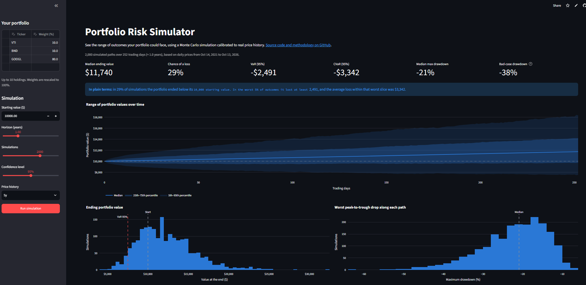
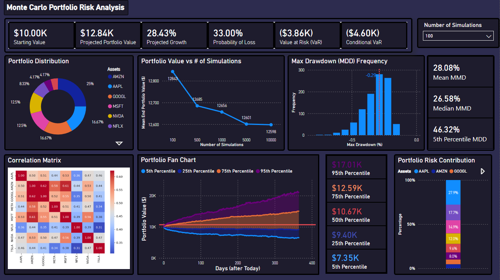

# Portfolio Risk Analysis

A Monte Carlo risk simulator for stock and ETF portfolios. Give it your holdings and it simulates thousands of possible futures from real price history, then reports how bad things could get: value at risk (VaR), conditional VaR (CVaR), probability of loss, and maximum drawdown.

**[Try the live demo](https://stockportfolioriskanalysis-grdp5rrupy5dhsvgwkz4ea.streamlit.app/)** &nbsp;·&nbsp; enter your own portfolio and see the results in seconds.

<!-- Add a screenshot or GIF of the live app here, e.g.:

-->

## Two ways to use it

| | Live demo (Streamlit) | Batch pipeline (Power BI) |
|---|---|---|
| **Best for** | Trying your own portfolio instantly | Comparing portfolios and building a polished dashboard |
| **Input** | Tickers and percentage weights in the browser | `tickers.csv` with share counts |
| **Output** | Interactive charts and KPIs | CSVs in `data/` feeding a Power BI dashboard |
| **Runs** | Hosted, or locally with `streamlit run app.py` | Locally via Makefile or Docker |

Both run the **same simulation code** (`src/core.py`), so they always agree. See [Architecture](#architecture).

## Introduction

### Problem I
Despite the continuous technological advances that have been made in conjunction with the finance industry, <b>there is no model</b> that has accurately captured the dynamic and unpredictable movements of the stock market. The features in order to predict the market are too multi-modal and complex in nature to capture and process. Furthermore, the trajectory of the market depends on future events that are unforeseeable. There is no definitive model, and there will probably never be one.

To the average investor that is interested in saving long-term, if there is no perfect model, how can one safely grow their portfolio? One way to approach this issue is to <b> account for risk.</b> If an investor can quantify risk, he/she/they can optimize their portfolio that withstand loss. But how do we even quantify risk in the first place? 

### Solution (Monte Carlo Simulation)
One popular solution, to quantify risk as an objective metric, is to see all the potential portfolio values after `N` days using the <b>Monte Carlo Algorithm</b>.

The [Monte Carlo Algorithm](https://en.wikipedia.org/wiki/Monte_Carlo_method) is a mathematical technique that entails utilizing random sampling to estimate the potential outcomes of an uncertain system (in this case, our portfolio value after fluctuations in the stock market).

How do we apply this technique to our portfolio? We randomly sample the movements (events) in the stock market and combine it with our portfolio value. This process requires:
- Compiling share prices over a period of `N` days
- Calculating the variance, mean returns, and the degrees of freedom of each share
- Computing a covariance matrix that captures the relationship between different shares in one portfolio
  - E.g. if NVDA's share price decreases, how will AMZN's share price behave?
- Using linear algebra (matrix multiplication) to simulate how one's portfolio turns out everyday until `N` days is reached
- Do the previous step again many times (e.g. 1000 times) to create a distribution of potential portfolio earnings like a normal distribution or student's t-distribution
- Present the portfolio distribution along with key risk indicators captured such as value at risk (VaR), conditional value at risk (CVaR), and maximum drawdown (MDD) in a dashboard for an investor to decide whether the risk associated with their portfolio is acceptable.

Presenting these metrics in a dashboard gives an investor an objective basis for deciding whether a portfolio's risk profile fits their tolerance:


  
## Comparative Portfolio Analysis
 
### Problem II
 
It is known that investing in a conservative portfolio of index funds (both equities and bonds) is less risky than investing in a tech-concentrated portfolio. Tech shares (e.g. AAPL, AMZN, NVDA) carry unstable prices since their valuations depend heavily on meeting future growth expectations rather than current fundamentals. By theory, Monte Carlo should predict lower risk metrics for the conservative portfolio and higher risk metrics for the tech-concentrated portfolio — but *by how much*?
 
To answer this, the pipeline was run against three portfolios, each starting at $10,000, over 10,000 simulations:
 
- **Conservative (60/40)** — 60% VTI, 40% BND
- **All-Weather (Ray Dalio)** — 30% VTI, 40% TLT, 15% IEF, 7.5% GLD, 7.5% DBC
- **Tech-Concentrated** — NVDA (12.5%), AAPL (16.7%), MSFT (12.5%), AMZN (25%), TSLA (4.16%), META (4.16%), NFLX (8.3%), GOOGL (16.6%)

| Metric | Tech-Concentrated | All-Weather | Conservative |
|---|---|---|---|
| Mean ending value | $12,597.78 | $10,305.38 | $11,034.67 |
| VaR (95%) | -31.5% | -16.9% | -10.7% |
| CVaR (95%) | -40.1% | -20.8% | -15.5% |
| Probability of loss | 30.3% | 43.2% | 23.0% |
| MDD (mean) | -27.7% | -12.5% | -10.8% |
| MDD (median) | -26.1% | -11.5% | -9.9% |
| MDD (5th pct., worst case) | -46.1% | -22.3% | -19.4% |
 
#### Findings
 
**Portfolio value.** As expected, Tech-Concentrated produced the highest ending value ($12,597.78, a 26.0% gain). Unexpectedly, Conservative ($11,034.67) outperformed All-Weather ($10,305.38), despite All-Weather's mandate of delivering steadier, regime-resilient returns. The simulated price history spans the 2022 rate-hike cycle — one of the worst periods on record for long-duration fixed income — and All-Weather's largest position, TLT (20+ year Treasuries, ~17-year duration), is roughly 2–3x more rate-sensitive than Conservative's BND (broad, mixed-maturity bonds, ~6-year duration). Combined with a smaller equity allocation (30% vs. 60%) to capture the subsequent recovery, this explains most of the gap.
 
**Portfolio risk.** VaR, CVaR, and MDD all descend in the expected order — Tech-Concentrated riskiest, Conservative safest — consistent with theory. Probability of loss breaks that pattern: All-Weather has the *highest* probability of ending below its starting value (43.2%), even higher than Tech-Concentrated's (30.3%). This is because severity and frequency of loss are different things. Tech-Concentrated's high expected return shifts its whole outcome distribution above breakeven, so most trials gain — but the minority that don't can be severe (worse CVaR/MDD). All-Weather's expected return is barely positive (3.1% over the horizon), so its distribution sits close to breakeven: losses are common but shallow. **Tech-Concentrated loses less often but loses harder; All-Weather loses more often but loses softer.**
 
**Recommendation.** None of the three is a strict winner. Comparing dollar gain to the magnitude of CVaR (an informal, directional stand-in for a Sharpe ratio — no risk-free rate, uses CVaR instead of standard deviation) shows Tech-Concentrated and Conservative are similarly efficient (~0.65 and ~0.67 gain per unit of tail risk), while All-Weather lags well behind (~0.15) — not because it's the riskiest, but because it delivers neither Tech's return premium nor Conservative's efficiency in this window. This doesn't invalidate All-Weather's risk-parity thesis; it means a 5-year backtest that includes one of the worst bond bear markets on record is a poor test of a strategy built for resilience across decades and multiple regimes.
 
- **Risk-averse investors** should prefer Conservative (60/40) over All-Weather here — similar efficiency to Tech-Concentrated with far less tail exposure.
- **Risk-tolerant investors** are reasonably compensated for Tech-Concentrated's volatility — its return-per-unit-of-risk is on par with Conservative's.
- **All-Weather** is the hardest to recommend from this simulation alone; evaluating its case fairly would need a longer backtest or forward-looking regime analysis.

## Architecture

```
                     yfinance (daily prices)
                              │
                              ▼
                    src/core.py  (shared engine)
        log returns → mean / variance / Student's-t d.o.f. → covariance
        → correlated t-distributed simulation (Cholesky, antithetic pairs)
        → VaR, CVaR, probability of loss, max drawdown, risk contribution
                 │                                  │
                 ▼                                  ▼
   CLI scripts + Makefile → data/*.csv      app.py (Streamlit)
                 │                                  │
                 ▼                                  ▼
        Power BI dashboard                    Live interactive demo
```

All numerical work lives in `src/core.py` as in-memory functions that never read or write files. The CLI scripts are thin wrappers that add file input/output around those functions, and `app.py` adds a web interface around the same functions. Fixing or improving the model in one place updates both.

The simulation is vectorized with NumPy: shocks are drawn for many trials at once, collapsed straight to one portfolio return per period (the portfolio return is linear in the shocks), and accumulated with a cumulative sum of log returns. Trials are generated in chunks to keep memory use flat. This runs 10,000 trials over 365 days in about a second or less for a typical portfolio.

## Live Demo

The Streamlit app (`app.py`) lets anyone enter a portfolio and see the results without installing anything.

**Inputs:** tickers and percentage weights (rescaled to 100%), starting value, horizon (up to 3 years), number of simulations, confidence level, and price-history length.

**Outputs:**
- Headline metrics: median ending value, chance of a loss, VaR, CVaR, median and bad-case drawdown
- Fan chart of the range of portfolio values over time
- Histograms of ending value and maximum drawdown
- Risk contribution by holding, and a correlation heatmap
- Per-holding historical return, volatility, and tail heaviness, plus a CSV download of the summary

**Limits** (to keep a free public host responsive): up to 10 tickers, up to 5,000 simulations, up to a 3-year horizon, and at least 250 days of overlapping price history. Price lookups are cached for an hour. Invalid inputs (unknown or duplicate tickers, zero weights, very recent listings) show a readable error instead of failing.

The hosted app may take a moment to wake if nobody has visited recently.

## Running the Project

Pick whichever path fits what you want to do.

### Option 1: Live demo

Use the [hosted app](https://YOUR-APP-NAME.streamlit.app). Nothing to install.

### Option 2: Run the app locally

Requires Python 3.12.

```bash
git clone https://github.com/holiday-sean/StockPortfolioRiskAnalysis.git
cd StockPortfolioRiskAnalysis

python -m venv .venv
# macOS / Linux:  source .venv/bin/activate
# Windows:        .venv\Scripts\activate
pip install -r requirements.txt

streamlit run app.py
```

### Option 3: Batch pipeline for your own portfolio (Power BI workflow)

Add your portfolio as `tickers.csv` in the repo root, with two columns: ticker symbol and number of shares you hold:

```csv
tickers,num_shares
AAPL,10
NVDA,5
```

The pipeline converts share counts into weights (each ticker's share of the total number of shares held), so these are share-count fractions, not dollar weights. To target specific percentages, choose share counts that produce them.

#### With Docker (recommended, especially on Windows)

Docker is the easiest path on Windows, since `make` isn't natively available there. The Dockerfile installs it inside the container.

1. **Run the pipeline:**
   ```bash
   docker-compose up --build portfolio_risk_analysis
   ```
   This builds the image and runs the full pipeline (`make all`) inside the container. Outputs are written to `data/` in your local repo (the `docker-compose.yml` volume mapping means you'll see the CSVs on your host machine, not just inside the container). If this step doesn't work, try creating an empty `data/` folder first and re-running.

2. **Run the web app in Docker instead** (optional):
   ```bash
   docker-compose up --build app
   ```
   Then open <http://localhost:8501>.

3. **Shut down:**
   ```bash
   docker-compose down
   ```
   This closes the Docker environment but keeps your generated data files intact.

4. **Re-run after changing your portfolio or the code:** use `--build` again, since the code is copied into the image at build time rather than mounted live.

5. **Start fresh:** delete everything inside `data/`, then re-run with `--build`.

#### With make (Linux / macOS)

If you already have GNU Make (version 4.3 or newer, because the Makefile uses grouped targets), you can skip Docker:

```bash
python -m venv .venv && source .venv/bin/activate
pip install -r requirements.txt
make all        # run the pipeline
make clean      # delete generated CSVs, then `make all` to start fresh
```

On Windows, Make versions older than 4.3 can't read the Makefile; use Docker, or run the scripts in `src/` one at a time in the order shown in [Pipeline flow](#pipeline-flow).

### Viewing your results in Power BI

Once the pipeline finishes, `data/` contains the simulation outputs (paths, summary risk statistics, convergence sweep, and so on; see [Project Structure](#project-structure)). Open `dashboard.pbit` in Power BI Desktop and, when prompted, set the `DataFolder` parameter to the absolute path of your local `data/` folder so the dashboard points at your own results with no code changes.

The Power BI dashboard can't be published online, which is why the live demo is a separate Streamlit app. The screenshot in the [Introduction](#introduction) shows the dashboard.

## Project Structure

```
.
├── app.py                     # Streamlit web app (live demo): inputs, validation, charts
├── requirements.txt           # Pinned dependencies (used by Docker, Streamlit hosting, local installs)
├── Dockerfile                 # Python 3.12-slim + make + pinned deps
├── docker-compose.yml         # Two services: the batch pipeline, and the web app on port 8501
├── Makefile                   # Orchestrates pipeline stages and their file dependencies
├── tickers.csv                # Batch pipeline input: ticker symbols + number of shares held
├── dashboard.pbit             # Power BI template: fan chart, MDD histogram,
│                              #   correlation heatmap, VaR/CVaR/MDD summary cards
├── docs/                      # README images
├── src/
│   ├── core.py                   # Shared engine: returns, statistics, simulation, risk metrics
│   │                              #   (in-memory functions, no file I/O; used by app.py and the scripts below)
│   ├── fetch_portfolio_dist.py   # tickers.csv → data/weights.csv (per-ticker portfolio weight)
│   ├── fetch_prices.py           # tickers.csv → data/prices.csv (5y daily Close, via yfinance)
│   ├── compute_returns.py        # data/prices.csv → data/returns.csv (daily log returns)
│   ├── compute_statistics.py     # data/returns.csv → data/stats.csv, data/covariance_matrix.csv
│   │                              #   (mean return, variance, t-distribution deg. of freedom per asset)
│   ├── simulate_portfolio.py     # Runs the Monte Carlo simulation → data/simulations.csv
│   │                              #   (correlated t-distributed draws via Cholesky decomposition,
│   │                              #    antithetic variates for variance reduction)
│   ├── visualize_results.py      # data/simulations.csv → data/simulation_paths.csv,
│   │                              #   data/simulation_summary.csv, data/mdd_distribution.csv
│   │                              #   (VaR, CVaR, probability of loss, max drawdown)
│   ├── analyze_convergence.py    # Sweeps n_simulations → data/convergence.csv
│   │                              #   (checks whether risk metrics have stabilized)
│   └── compute_risk.py           # covariance_matrix.csv + weights.csv → data/risk_contribution.csv
│                                  #   (variance-based risk decomposition per asset)
└── data/                      # Pipeline outputs: gitignored, regenerated on every run
```

## Pipeline flow

This is the batch pipeline (the Makefile path). The live app runs the same steps in memory instead of through CSV files.

```
tickers.csv
   ├──► fetch_portfolio_dist.py ──► weights.csv ──────────────────┐
   └──► fetch_prices.py ──► prices.csv                            │
              │                                                   │
              ▼                                                   │
     compute_returns.py ──► returns.csv                           │
              │                                                   │
              ▼                                                   │
  compute_statistics.py ──► stats.csv, covariance_matrix.csv ─┐   │
              │                                                │   │
              │                                                ▼   ▼
              │                                    simulate_portfolio.py
              │                                                │
              │                                                ▼
              │                                          simulations.csv
              │                                          │         │
              │                                          ▼         ▼
              │                              visualize_results.py   analyze_convergence.py
              │                                          │         │
              │                                          ▼         ▼
              │                           simulation_paths.csv,   convergence.csv
              │                           simulation_summary.csv,
              │                           mdd_distribution.csv
              │
              └──► compute_risk.py (+ weights.csv) ──► risk_contribution.csv
```

## Dependencies

All dependencies are pinned in `requirements.txt`, which is the single source used by Docker, the hosted app, and local installs:

| Package | Version | Purpose |
|---|---|---|
| `numpy` | 2.5.1 | Linear algebra (Cholesky decomposition), vectorized random number generation |
| `pandas` | 3.0.5 | Data wrangling, CSV I/O |
| `yfinance` | 1.5.2 | Historical price data from Yahoo Finance |
| `scipy` | 1.18.0 | Student's t-distribution fitting (`scipy.stats.t.fit`) |
| `streamlit` | 1.65.0 | Web app framework for the live demo |
| `plotly` | 7.1.0 | Interactive charts in the live demo |

Install locally with:

```bash
pip install -r requirements.txt
```

If you're using Docker, you don't need to do this: the image installs the same pinned versions automatically.

**Power BI dashboard:** the correlation heatmap (derived from the covariance matrix) is rendered as a Python visual inside Power BI Desktop, which relies on Power BI's own separately-configured Python environment (Power BI Options → Python scripting), not the environment above. That environment needs `pandas`, `numpy`, `matplotlib`, and `seaborn` available.

**Orchestration:**
- `make`: installed via `apt-get` inside the Docker image; not required on the host if you're using Docker Compose
- Docker / Docker Compose: to build and run the pipeline or the web app without setting up Python locally

## Method notes and limitations

- **Historical assumptions.** The simulation assumes the average return and volatility seen in the price-history window continue. It answers "what if the next year looks like the last five?", not "what will happen?". Results lean heavily on whatever regime the window contains (for example, the 2022 rate hikes for long-duration bonds), as discussed in the comparative analysis above.
- **Distribution.** Daily returns are drawn from a Student's t distribution (fat tails) with each asset's fitted degrees of freedom, rescaled to unit variance, and correlated through the Cholesky factor of the covariance matrix. This is a common approximation, not a full multivariate t model.
- **Compounding.** Returns are log returns, so portfolio values compound as `exp(r)`.
- **Weights.** The live app takes percentage weights directly. The batch pipeline derives weights from share counts (see [Option 3](#option-3-batch-pipeline-for-your-own-portfolio-power-bi-workflow)).
- **Simplifications.** No rebalancing, trading costs, taxes, dividends beyond adjusted prices, or contributions. Prices are assumed to be in USD.

### Future work

- GARCH-based volatility and rolling correlations instead of a single fixed covariance matrix
- Automated tests (pytest) for `core.py`
- Longer or regime-specific backtest windows, for example to evaluate the All-Weather portfolio over a full rate cycle
